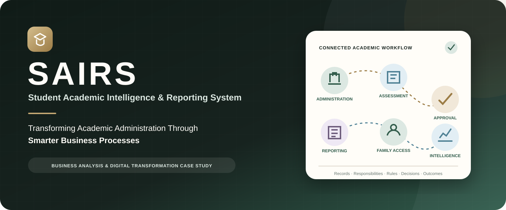
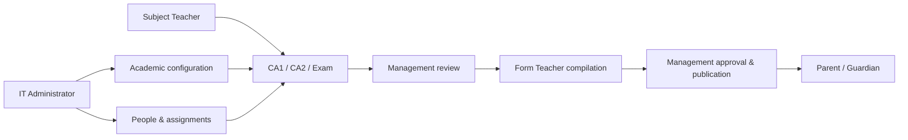
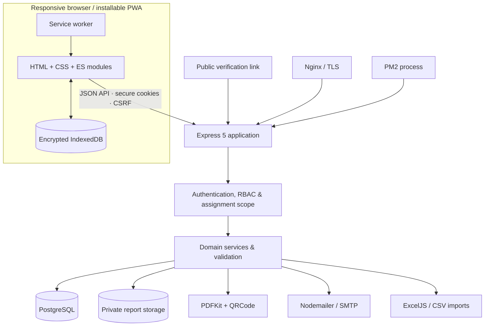
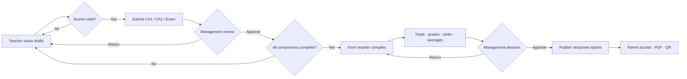
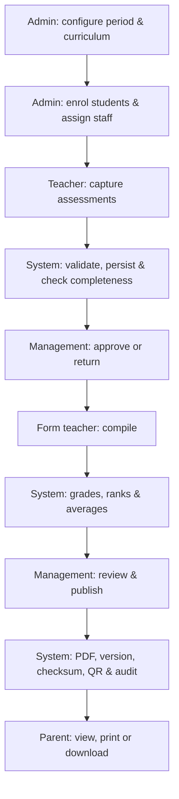
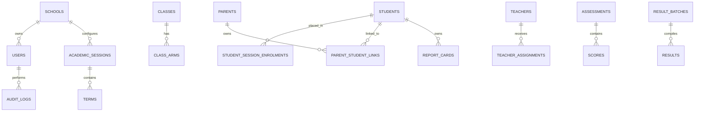

<p align="center"></p>

<p align="center"><strong>A secure, role-based platform for academic operations, intelligence, reporting, and family access.</strong></p>

<p align="center">
  
  
  
  
  
</p>

<p align="center"><a href="#project-overview">Overview</a> · <a href="#verified-capabilities">Capabilities</a> · <a href="#system-architecture">Architecture</a> · <a href="#academic-reporting-engine">Reporting Engine</a> · <a href="#installation-and-local-development">Setup</a> · <a href="docs/BUSINESS_CASE_STUDY.md">Business Case Study</a></p>

> **Audit snapshot — 18 October 2026:** 72 verified capabilities, 14 system modules, 4 authentication roles, 17 mapped business workflows, 268 passing tests, and 80 JavaScript files passing syntax validation. These figures describe the audited revision, not a permanent performance guarantee.

## Project overview

SAIRS is a full-stack Student Academic Intelligence & Reporting System that connects school configuration, student and staff records, assessment capture, academic review, result compilation, report publication, and parent access in one controlled workflow.

For school teams, it provides a coherent operational record from enrolment to published report. For engineers, it demonstrates multi-tenant data modelling, server-side authorisation, transactional imports, deterministic academic calculations, immutable report revisions, public verification, and encrypted offline workflows. For business analysts and transformation leaders, it shows how stakeholder needs and approval rules can become working software.

## The business problem

Academic administration often spans disconnected registers, spreadsheets, manual calculations, informal approvals, and files that are difficult to retrieve reliably. This creates practical challenges:

- assessment records are repeatedly transferred and recalculated;
- student, guardian, class, and staff context can become fragmented;
- missing scores may be discovered late in report preparation;
- approval responsibilities are difficult to make explicit and trace;
- historical placements and published results can be hard to reconstruct;
- parents need secure access to the correct published version; and
- intermittent connectivity can interrupt classroom data entry.

SAIRS treats these as workflow and information-governance problems—not simply screens to digitise.

## The SAIRS solution

| Operational challenge | Verified SAIRS response |
|---|---|
| Fragmented academic setup | Tenant-scoped sessions, terms, classes, arms, subjects, curriculum and grading rules |
| Repetitive onboarding | Atomic student/guardian and teacher/account workflows, plus validated bulk imports |
| Inconsistent score capture | Assignment-scoped CA1, CA2 and Examination entry with component maxima and drafts |
| Incomplete results | Roster and curriculum completeness gates before form-teacher compilation |
| Manual calculations | Deterministic totals, grades, subject positions, averages and overall ranking |
| Informal approvals | Progressive component review and routed class-result review, return, approval and publication |
| Weak report provenance | Versioned snapshots, checksums, QR verification, publication metadata and audits |
| Limited family visibility | Linked-child access to approved progress and latest published reports |
| Difficult historical retrieval | Session enrolments, class history and immutable report revisions |
| Unreliable connectivity | Encrypted offline snapshots and conflict-aware queued teacher score updates |

## Verified capabilities

<table>
<tr><td><strong>Academic administration</strong><br>School profile, periods, classes, curriculum, grading, rollover and promotion.</td><td><strong>People and access</strong><br>Student/guardian, teacher and management onboarding with relationship boundaries.</td></tr>
<tr><td><strong>Assessment operations</strong><br>Assigned rosters, CA1/CA2/Exam drafts, validation, submission, history and component review.</td><td><strong>Result intelligence</strong><br>Calculations, grades, competition ranking, averages, trends, risks and recommendations.</td></tr>
<tr><td><strong>Reports and verification</strong><br>Browser preview, PDF, email, print, versioning, checksums and public QR verification.</td><td><strong>Continuity and governance</strong><br>History, audits, encrypted offline access, synchronisation and recoverable import jobs.</td></tr>
</table>

Explore the complete catalogue in [Verified Features](docs/FEATURES.md).

## Application user roles

SAIRS implements **four authentication roles**. Subject Teacher and Form Teacher are responsibility types assigned to a user with the `TEACHER` role.

| Capability | IT Administrator | Management | Subject Teacher | Form Teacher | Parent/Guardian |
|---|:---:|:---:|:---:|:---:|:---:|
| Configure academic structure | ● | — | — | — | — |
| Manage students, guardians and staff | ● | — | — | — | — |
| Enter assigned scores | Oversight | — | ● | When subject-assigned | — |
| Review assessment components | — | ● | — | — | — |
| Compile and rank class results | Oversight | — | — | ● | — |
| Review, approve and publish | Oversight | ● | — | — | — |
| View performance | School | School | Assignment | Class | Linked children |
| View published reports | ● | ● | Form-class | ● | Linked children |
| Audit access | Full | Own | Own | Own | Own |



## Application showcase

The repository contains no fabricated screens and no production student data. A privacy-safe 20-screen capture plan is ready in [Screenshot Guide](docs/SCREENSHOT_GUIDE.md). Until synthetic staging captures are produced, this README avoids broken placeholders. The planned gallery covers administration, onboarding, assessment entry, component review, compilation, publication, parent access, performance history, report verification, audit activity, and mobile/offline operation.

## System architecture



The application is a modular monolith. The browser SPA calls role-gated Express routes; services enforce tenant and object scope before PostgreSQL access. Reports live outside the public directory and are delivered through authorised endpoints. Public verification resolves only a published, integrity-valid artifact. See [Architecture](docs/ARCHITECTURE.md).

## Academic reporting engine

The standard teacher workflow uses **CA1 / 20**, **CA2 / 20**, and **Examination / 60**.

```text
component contribution = raw score ÷ component maximum × component weight
total weighted score   = sum of component contributions
percentage             = total weighted score ÷ sum of weights × 100
student average        = mean of compiled subject totals
```

With the standard 20/20/60 structure, total is `CA1 + CA2 + Examination`, out of 100. An active inclusive grading rule supplies the grade and remark. Subject and overall positions use competition ranking: tied scores share a rank and the next position skips accordingly.



See [Academic Reporting](docs/ACADEMIC_REPORTING.md) for formulas, gates and publication rules.

## Business process automation

Teachers remain responsible for score accuracy; management remains responsible for review and publication. SAIRS automates validation, completeness checks, calculation, ranking, routing, versioning and traceability around those decisions.



All 17 audited workflows are documented in [Business Workflows](docs/BUSINESS_WORKFLOWS.md).

## Database design

PostgreSQL is authoritative. Tenant identifiers, foreign keys, constraints, unique indexes, versions, transaction locks, workflow history and publication snapshots reinforce integrity.



## Security and data protection

Verified controls include Argon2id password hashing, forced first-login password changes, opaque server sessions in HttpOnly cookies, CSRF protection, throttling/account locks, fixed role and relationship checks, validation and database constraints, parameterised SQL, Helmet/CSP, AES-GCM encrypted offline data, private report storage, integrity checks, and audit trails.

These are implementation findings, not a claim of independent certification or absolute security. Review [Security Architecture](docs/SECURITY.md) and [Vulnerability Reporting](SECURITY.md).

## Technology stack

| Area | Technologies | Purpose |
|---|---|---|
| Frontend | HTML5, CSS3, JavaScript ES modules | Responsive role-based SPA |
| Backend | Node.js 20+, Express 5 | API and domain orchestration |
| Database | PostgreSQL, `pg` | Relational records and transactions |
| Validation/security | Zod, Argon2id, Helmet, CSRF, Web Crypto | Input, identity and offline protection |
| Reporting | PDFKit, QRCode, Nodemailer | PDFs, verification and email |
| Data processing | ExcelJS, JSZip, CSV services | Templates, imports and exports |
| PWA | Manifest, service worker, IndexedDB | Installation, caching and offline work |
| Operations | dotenv, PM2, Nginx | Configuration and deployment |
| Testing | Node test runner, syntax checker | Domain/security/UI contracts |

## Testing and quality

At the 18 October 2026 audit checkpoint, `npm test` completed **268 passed, 0 failed, 0 skipped**, and `npm run check` parsed **80 JavaScript files**. Re-run safely with:

```bash
npm ci
npm test
npm run check
```

The suite does not replace staging acceptance, live database integration, browser accessibility, dependency or penetration testing.

## Installation and local development

Prerequisites: Node.js 20+, PostgreSQL with a dedicated local database, and optional SMTP for report email.

```bash
git clone https://github.com/Ogbunugafor-Philip/Student-Academic-Intelligence-Reporting-System-SAIRS-.git
cd Student-Academic-Intelligence-Reporting-System-SAIRS-
npm ci
cp .env.example .env
# Replace every placeholder locally; never commit .env.
npm run migrate:status
npm run migrate
node scripts/bootstrap-school.js
npm test
npm run check
npm run dev
```

Migrations and bootstrap change the configured database: never point them at production during development. See [Development Setup](docs/DEVELOPMENT_SETUP.md) and [Deployment](DEPLOYMENT.md).

## Business analysis and digital transformation value

SAIRS demonstrates a delivery path from stakeholder problem and process mapping, through domain and business-rule modelling, to workflow automation, implementation, auditability and verification. Automation handles repeatable validation and calculation while human accountability remains explicit at score entry and approval. It is a functioning transformation case study, not a claim of measured time, cost or attainment gains. Read the [Business Case Study](docs/BUSINESS_CASE_STUDY.md).

## Future development roadmap

The following are **not completed features**: automated backup scheduling and restore drills; a general notification centre; custom permissions beyond four fixed roles; attendance; controlled unpublish; MFA and self-service recovery; CI/browser/accessibility/integration coverage; and the synthetic screenshot gallery.

## Repository structure

```text
SAIRS-WEB/
├── public/                 # SPA, styles, PWA shell and safe assets
├── src/
│   ├── db/migrations/      # PostgreSQL schema evolution
│   ├── middleware/         # Authentication, CSRF and validation
│   ├── routes/             # API and public verification routes
│   ├── services/           # Academic domain logic
│   ├── reports/            # PDF generation and storage adapter
│   └── security/           # Password and crypto protections
├── test/                   # Automated Node.js tests
├── scripts/                # Checks, bootstrap and import tools
├── docs/                   # Product and technical documentation
├── nginx/                  # Reverse-proxy example
├── server.js               # Entry point
└── package.json            # Dependencies and commands
```

Secrets, dumps, generated reports, imports, caches, logs and dependencies are excluded from version control.

## Project author

### Philip Osita Ogbunugafor

**Business Analyst | Business Performance Intelligence | Digital Transformation**

Designed and implemented SAIRS as a portfolio-scale product connecting requirements analysis, workflow redesign, database architecture, full-stack engineering, reporting and quality assurance. GitHub: [Ogbunugafor-Philip](https://github.com/Ogbunugafor-Philip).

## Licensing and contributions

No open-source licence has been granted. Copyright remains with the author; public visibility alone does not grant permission to copy, modify, distribute or commercially reuse the source. Discuss contribution terms before submitting substantial code. Report vulnerabilities privately as described in [SECURITY.md](SECURITY.md).

---

<p align="center"><strong>SAIRS</strong> · Academic records with structure, intelligence and trust.</p>
