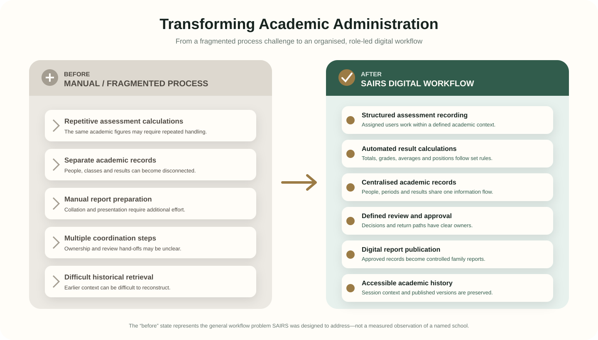
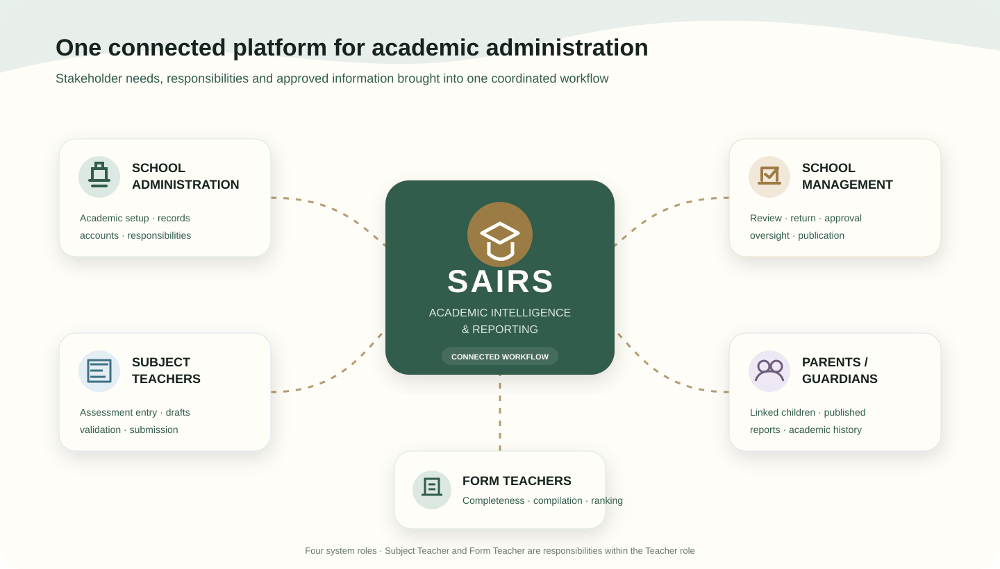
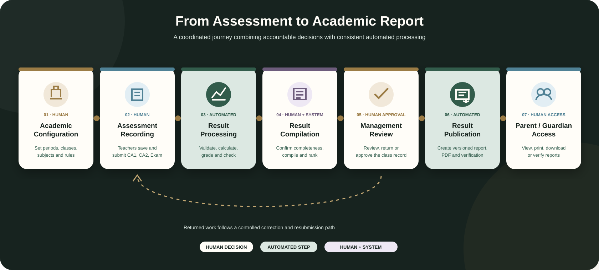
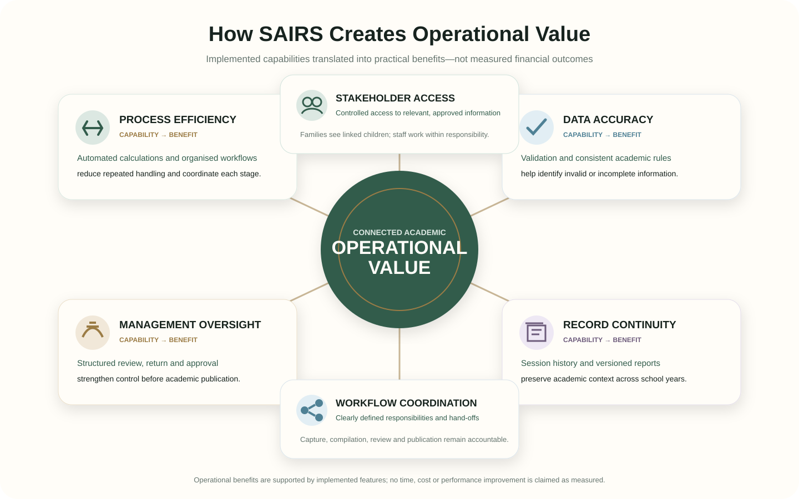

  <a href="#project-overview">Overview</a> ·
  <a href="#the-business-challenge">Challenge</a> ·
  <a href="#stakeholders--business-requirements">Requirements</a> ·
  <a href="#how-the-solution-works">Solution</a> ·
  <a href="#business-value">Business Value</a> ·
  <a href="#my-contribution">Contribution</a>

## Project overview

**SAIRS** is a Student Academic Intelligence & Reporting System designed to organise the journey from academic setup and assessment recording to result approval, publication, and parent access.

The project is a practical business transformation case study. It shows how an operational challenge can be analysed, converted into clear requirements, redesigned as a coordinated workflow, and delivered as a working solution. The emphasis is on better process control, clearer stakeholder responsibility, consistent academic rules, and continuity of information across school sessions.

## The business challenge

Academic reporting involves many connected activities: enrolling students, assigning teachers, recording assessments, checking completeness, calculating results, reviewing performance, preparing reports, and sharing approved information with families.

When these activities depend on separate records and informal hand-offs, several business risks can emerge:

- assessment figures require repeated handling and calculation;
- incomplete entries become visible late in report preparation;
- responsibility for review and correction is unclear;
- student, class, guardian, and subject information becomes fragmented;
- earlier academic records are difficult to retrieve in context; and
- parents have limited access until reports are manually distributed.

These represent the general workflow problems SAIRS was designed to address. They are not presented as measured observations of a named school.

## Before vs after transformation

The improved process reduces duplicated handling, makes responsibilities visible, and connects assessment, review, reporting, and access. Automation supports the process without removing human accountability for score entry or academic approval.

## Stakeholders & business requirements

| Stakeholder | Primary business need | SAIRS response |
|---|---|---|
| **School Management** | Visibility and control before results are released | Review queues, return and approval decisions, performance visibility, controlled publication |
| **IT / School Administration** | Consistent structures, records, accounts, and responsibilities | Academic setup, onboarding, imports, assignments, continuity, and audit visibility |
| **Subject Teachers** | A clear way to record scores for assigned students | Assigned rosters, draft saving, validation, and CA1, CA2, and Exam submission |
| **Form Teachers** | Confidence that a complete class record is submitted | Completeness checks, compilation, averages, and academic positions |
| **Parents / Guardians** | Private access to authentic, approved information | Linked-child access, published reports, downloads, history, and verification |

SAIRS implements four system roles. Subject Teacher and Form Teacher are distinct responsibilities within the Teacher role—not separate authentication roles.

The requirements translated into eight core areas: people and responsibility records; controlled assessment capture; repeatable academic calculations; role-based access; management review; parent access; historical continuity; and formal academic reporting. The implemented application provides traceable capabilities for each area without claiming that formal workshops or signed requirements documents were completed.

## How the solution works

1. **Academic configuration** — Administration defines sessions, terms, classes, subjects, grading rules, enrolment, and staff responsibilities.
2. **Assessment recording** — Subject teachers record CA1, CA2, and Examination scores within their assigned academic context.
3. **Automated processing** — SAIRS validates score limits, checks context and completeness, and calculates results using defined rules.
4. **Result compilation** — Form teachers compile complete class records; averages and academic positions are calculated consistently.
5. **Management review** — Management reviews the evidence and can return, approve, or progress the result.
6. **Result publication** — Approved records become versioned academic reports with printable PDF and verification support.
7. **Parent access** — Authorised parents can view, print, download, or verify reports for linked children.

## Key business capabilities

<table>
<tr><td><strong>Academic Records Management</strong> Organised student, guardian, staff, class, subject, and academic-period information.</td><td><strong>Assessment &amp; Results Processing</strong> Validated score capture and consistent calculation of totals, grades, averages, and positions.</td></tr>
<tr><td><strong>Workflow Coordination</strong> Clear hand-offs across administration, teaching, compilation, review, and publication.</td><td><strong>Academic Reporting</strong> Structured report preparation, approval, publication, download, email, and verification.</td></tr>
<tr><td><strong>Parent Engagement</strong> Controlled access to approved progress and published results for linked children.</td><td><strong>Historical Continuity</strong> Retrieval of earlier periods without losing the context in which records were created.</td></tr>
</table>

The complete evidence-based catalogue is available in [Verified Features](docs/FEATURES.md).

## Business value

| Implemented capability | Demonstrated operational benefit |
|---|---|
| Automated calculations and grading | Reduces reliance on repetitive manual computation and applies rules consistently |
| Assignment-based work and approval stages | Clarifies who records, compiles, reviews, and publishes information |
| Score limits and completeness checks | Helps identify invalid or missing entries before official compilation |
| Central records and session history | Makes current and earlier academic information easier to manage and retrieve |
| Review, return, approval, and publication states | Strengthens oversight and prevents informal movement from entry to release |
| Linked-child parent access | Gives authorised families direct access to published academic information |
| Versioned reports and verification | Preserves what was issued and supports confidence in report authenticity |

These are practical benefits demonstrated by the implemented capabilities. No adoption figures, time savings, cost reductions, or attainment improvements have been measured or claimed.

## My contribution

### Philip Osita Ogbunugafor

**Business Analyst | Business Performance Intelligence | Digital Transformation**

I framed academic reporting as an end-to-end business process rather than a collection of isolated tasks. My contribution covered:

- identifying the operational problem and its connected information needs;
- interpreting stakeholder needs and translating them into solution requirements;
- defining assessment, calculation, completeness, ranking, and approval rules;
- structuring responsibilities and decision points across each user group;
- redesigning hand-offs as visible, controlled workflows;
- implementing the solution as a functioning digital product; and
- validating that the delivered capabilities work together as intended.

The evidence supports these analytical and delivery activities. It does not claim formal stakeholder workshops, signed business requirements, an external delivery team, or independently measured organisational outcomes. Software development was the delivery mechanism; the central portfolio story is understanding an operation and turning that understanding into a practical solution.

## Project validation

| Evidence | Verified position at the 18 October 2026 audit |
|---|---|
| Delivered capability | **72 implemented features** across 14 system modules |
| Process coverage | **17 documented business workflows** |
| Stakeholder model | **4 roles**, with 2 teacher responsibility types |
| Functional assurance | Assessment, calculation, compilation, approval, publication, history, and parent access confirmed |
| Automated verification | **268 of 268 tests passing** at the audit checkpoint |

These results establish implementation evidence; they do not imply production adoption or guarantee future test status.

## Technical documentation

Technical implementation is intentionally secondary here. SAIRS uses Node.js, Express, PostgreSQL, and a responsive progressive web interface. Detailed reference material remains available for technical readers:

[Architecture](docs/ARCHITECTURE.md) · [Academic Reporting](docs/ACADEMIC_REPORTING.md) · [Business Workflows](docs/BUSINESS_WORKFLOWS.md) · [Security](docs/SECURITY.md) · [Development Setup](docs/DEVELOPMENT_SETUP.md) · [Feature Inventory](docs/FEATURES.md) · [Business Case Study](docs/BUSINESS_CASE_STUDY.md)

No open-source licence has been granted. Public visibility does not grant permission to copy, modify, distribute, or commercially reuse the source.

---

<strong>SAIRS</strong> · Better processes. Clearer decisions. Trusted academic records.

