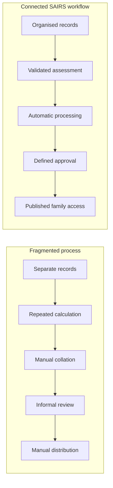
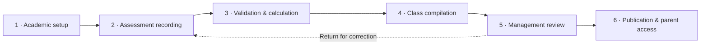

<strong>A Business Analysis &amp; Digital Transformation Case Study</strong>

  <a href="#the-business-challenge">Challenge</a> ·
  <a href="#stakeholder-analysis">Stakeholders</a> ·
  <a href="#business-process-analysis-before-vs-after">Process Improvement</a> ·
  <a href="#requirements-analysis">Requirements</a> ·
  <a href="#business-value-delivered">Business Value</a> ·
  <a href="docs/BUSINESS_CASE_STUDY.md">Detailed Case Study</a>

## Project overview

SAIRS is a Student Academic Intelligence & Reporting System created to organise the journey from academic setup and assessment recording to result approval, publication, and parent access.

The project demonstrates how an operational challenge can be analysed, redesigned, and supported through a practical digital solution. Its focus is not technology for its own sake. It is about giving each stakeholder a clear responsibility, reducing repetitive processing, improving the quality of academic records, and preserving information across school sessions.

## The business challenge

Academic reporting involves many connected activities: enrolling students, assigning teachers, recording assessments, calculating results, checking completeness, reviewing performance, preparing reports, and sharing approved information with families.

When these activities depend on disconnected registers, spreadsheets, and informal hand-offs, several business risks emerge:

- scores may be transferred or calculated repeatedly;
- incomplete entries may only become visible during report preparation;
- teachers and management may lack a clear review path;
- student, guardian, class, and subject records can become fragmented;
- retrieving earlier academic records becomes difficult as students change classes;
- report preparation and distribution require avoidable manual coordination; and
- parents have limited visibility until results are formally shared.

These are general workflow problems the solution was designed to address. The repository does not claim that a formal study of a particular school or measured baseline was completed.

## Business objectives

SAIRS was designed to:

1. **Create one organised academic workflow** from setup through publication.
2. **Reduce repetitive processing** by automating validation, calculations, ranking, and report generation.
3. **Clarify accountability** across administrators, subject teachers, form teachers, and management.
4. **Improve record quality** by identifying invalid or incomplete assessment information before compilation.
5. **Strengthen academic oversight** through defined review, return, approval, and publication stages.
6. **Improve access to information** by giving authorised parents controlled access to published results.
7. **Preserve continuity** through session-based enrolment, academic history, and versioned reports.

## Stakeholder analysis

| Stakeholder | Business need | How SAIRS addresses it |
|---|---|---|
| School Management | Visibility, control, and confidence before results are released | Review queues, return/approval decisions, performance views, and controlled publication |
| IT / School Administrator | Consistent academic structures, records, accounts, and responsibilities | Configuration, onboarding, bulk imports, assignments, continuity, and audit visibility |
| Subject Teacher | A clear way to record scores for assigned students and subjects | Assignment-based rosters, draft saving, validation, and separate CA1, CA2, and Exam submission |
| Form Teacher | Confidence that a class record is complete before submission | Completeness checks, class compilation, averages, and academic positions |
| Parent / Guardian | Private access to authentic, approved academic information | Linked-child access, published reports, history, downloads, and report verification |

SAIRS uses four system roles. Subject Teacher and Form Teacher are responsibilities within the Teacher role rather than separate login types.

## Business process analysis: before vs after

“Before” represents the fragmented workflow problem the project addresses; it is not presented as a measured observation of a named school.

| Before SAIRS | After SAIRS |
|---|---|
| Records may sit across separate files and registers | Academic context and records follow one connected process |
| Scores require repeated transfer and calculation | Scores are validated and results are calculated automatically |
| Missing work may surface late | Completeness is checked before class compilation |
| Responsibilities and approvals can be informal | Each stage has an authorised owner and defined decision |
| Reports require manual preparation and distribution | Approved records produce structured, publishable reports |
| Earlier records can be difficult to reconstruct | Session history and published report versions are preserved |

## Requirements analysis

The implemented solution reflects the following major business requirement categories. These requirements are evidenced by the application; the project does not claim that formal workshops or signed requirements documents were completed.

| Business need | Requirement | Delivered solution |
|---|---|---|
| Reliable people records | Manage students, guardians, teachers, and responsibilities | Searchable records, linked family accounts, staff assignments, and controlled status changes |
| Consistent assessment capture | Record scores within defined limits and scope | Assigned rosters, component boundaries, drafts, submission, and score history |
| Accurate processing | Apply repeatable academic rules | Automated totals, grades, remarks, averages, and competition ranking |
| Clear responsibility | Restrict work to authorised users | Administrator, management, teacher, and parent access boundaries |
| Academic oversight | Review evidence before release | Component approval plus class-result review, return, approval, and publication |
| Family access | Share only approved student information | Linked-child access to current approved progress and published reports |
| Historical continuity | Preserve context as classes and sessions change | Session enrolments, class history, and versioned publication snapshots |
| Formal reporting | Produce consistent academic reports | Browser reports, printable PDFs, secure downloads, email, and verification |

## The solution: how SAIRS works

1. **Academic setup** — An authorised administrator defines sessions, terms, classes, subjects, grading rules, student enrolment, and staff responsibilities.
2. **Assessment recording** — Subject teachers record CA1, CA2, and Examination scores for students within their assignments. Work can be saved before final submission.
3. **Automated processing** — SAIRS validates score limits and academic context, checks completeness, and calculates totals and grades using configured rules.
4. **Result compilation** — The responsible form teacher compiles a complete class record. The system calculates subject positions, student averages, and overall positions.
5. **Management review** — School management can review, return, approve, and publish the compiled results. Human approval remains explicit.
6. **Publication** — Approved results become versioned academic reports that authorised parents can view, print, download, or verify.

## Key business capabilities

| Capability | What it enables |
|---|---|
| **Academic records management** | Organised student, guardian, staff, class, subject, and academic-period information |
| **Assessment and results processing** | Validated score capture and consistent calculation of totals, grades, averages, and positions |
| **Workflow coordination** | Clear hand-offs and decision rights across administration, teaching, compilation, and management |
| **Academic reporting** | Structured report preparation, approval, publication, download, email, and verification |
| **Parent engagement** | Controlled access to approved progress and published results for linked children |
| **Historical record management** | Retrieval of earlier academic periods without losing the context in which records were created |

The detailed evidence-based inventory is available in [Verified Features](docs/FEATURES.md).

## Project showcase: see SAIRS in action

No production records or fabricated interface images are included. A privacy-safe gallery will be added after the application is captured in an isolated demonstration environment using entirely synthetic data.

The planned showcase prioritises the administration dashboard, student records, assessment entry, form-teacher compilation, management approval, academic report card, parent portal, and historical records. See the [Screenshot Guide](docs/SCREENSHOT_GUIDE.md) for the capture and privacy standard.

## Business value delivered

The value below is demonstrated by implemented capabilities. It represents operational benefit, not a measured financial or performance outcome.

| Implemented capability | Demonstrated operational benefit |
|---|---|
| Automated totals, grades, averages, and positions | Reduces reliance on repetitive manual computation and applies rules consistently |
| Assignment-based workspaces and approval stages | Clarifies who records, compiles, reviews, and publishes academic information |
| Score limits and completeness checks | Helps identify invalid or missing entries before official compilation |
| Central academic records and session history | Makes current and earlier information easier to manage and retrieve |
| Review, return, approval, and publication states | Strengthens oversight and prevents an informal jump from entry to release |
| Linked-child parent access | Gives authorised families direct access to published academic information |
| Versioned reports and verification | Preserves what was issued and supports confidence in report authenticity |
| Bulk imports, rollover, and offline score work | Supports recurring school operations and intermittent connectivity |

No adoption numbers, time savings, cost reductions, or attainment improvements have been measured in this repository.

## My Contribution

### Philip Osita Ogbunugafor

**Business Analyst | Business Performance Intelligence | Digital Transformation**

My contribution was to frame the academic reporting challenge as an end-to-end business process, translate operational needs into system behaviour, define academic processing and validation rules, structure stakeholder responsibilities, design improved workflows, implement the solution, and verify that the delivered capabilities work together.

The project evidence supports responsibility for requirements interpretation, process and data modelling, business-rule definition, workflow design, solution delivery, and functional validation. It does not claim formal stakeholder workshops, signed business requirements documents, an external project team, or independently measured organisational outcomes.

Software development was the delivery mechanism. The core portfolio story is the ability to understand an operation and turn that understanding into a usable, controlled process.

## Validation and project evidence

- **72** capabilities verified against the implemented project
- **17** end-to-end business workflows documented
- **4** user roles with **2** distinct teacher responsibility types
- Academic assessment, compilation, approval, publication, history, and parent access confirmed
- **268/268** automated tests passed at the 18 October 2026 audit checkpoint
- Sensitive environment files, generated reports, and database backups excluded from publication

These figures describe the audited revision and do not imply production adoption or future test status.

## Key lessons and transferable skills

SAIRS demonstrates practical capability in problem definition, stakeholder analysis, requirements structuring, process improvement, workflow and decision design, business rules, data validation, systems thinking, solution evaluation, and technology-enabled transformation. It also shows how to preserve human accountability while automating repeatable operational work.

## Technical documentation

Technical implementation is intentionally secondary in this case study. SAIRS is built with Node.js, Express, PostgreSQL, and a responsive progressive web interface. Detailed material is available here:

- [Technical architecture](docs/ARCHITECTURE.md)
- [Academic reporting rules](docs/ACADEMIC_REPORTING.md)
- [Business workflows](docs/BUSINESS_WORKFLOWS.md)
- [Security architecture](docs/SECURITY.md)
- [Development setup](docs/DEVELOPMENT_SETUP.md)
- [Deployment guide](DEPLOYMENT.md)
- [Detailed feature inventory](docs/FEATURES.md)
- [Business analysis case study](docs/BUSINESS_CASE_STUDY.md)

No open-source licence has been granted. Public visibility does not grant permission to copy, modify, distribute, or commercially reuse the source.

---

<strong>SAIRS</strong> · From manual academic administration to streamlined digital workflows.

