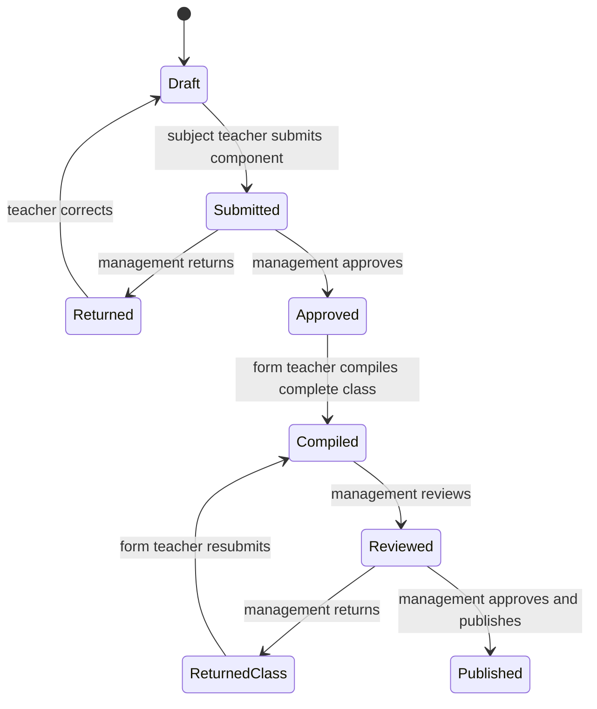

# Academic Reporting Engine

[← README](../README.md) · [Features](FEATURES.md) · [Workflows](BUSINESS_WORKFLOWS.md)

## Assessment model

The focused teacher workspace ensures three components: CA1 (maximum and weight 20), CA2 (20), and Examination (60). The generic engine also supports configured maximums and weights.

For each recorded component:

```text
contribution = score / maximum score × weight
CA total     = sum of non-examination contributions
Exam total   = sum of examination contributions
weighted     = CA total + Exam total
percentage   = round(weighted / total configured weight × 100, 2)
```

Under the standard 20/20/60 structure, the raw values are already weighted and the result is out of 100. Output components and totals are rounded to two decimals.

## Grade and remark

Active grading rules contain inclusive minimum/maximum bounds, a grade and a remark. Rules are ordered, and the first range containing the percentage is selected. Administration validation rejects gaps, overlaps, duplicates and invalid bounds. Calculation fails when no active range covers the score.

## Completeness and validation

- Scores must be numeric and within each component maximum.
- Term must belong to the selected academic session.
- The teacher must hold the relevant active assignment.
- Academic identity cannot be changed after scores/workflow records exist.
- Drafts may be incomplete.
- Official form-teacher compilation requires CA1, CA2 and Exam approved for every curriculum subject and enrolled student.

## Ranking

Subject position is derived by sorting subject totals descending. Overall position sorts student averages descending. Both use competition ranking (`1, 2, 2, 4`); equal values share a rank. Admission number stabilises display order for equal scores. Student average is the arithmetic mean across compiled subjects, rounded to two decimal places.

## Approval and publication



Publication generates a versioned report-card artifact and JSON snapshot with checksum, actor/time, supersession and verification material. The latest published revision is the effective parent/form-teacher report. Published reports may be viewed, printed, downloaded, emailed, or verified by QR/token.

## Academic intelligence

Performance analysis uses published results only. Direction is improving at +2 points or more, declining at −2 or less, otherwise stable. Default risk signals include below 50, two repeated failures, a three-observation decline, a 15-point sudden drop, and three current subject failures. Recommendations are advisory; they do not alter grades.
