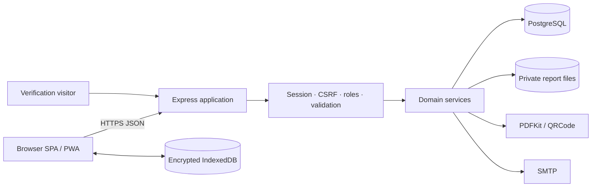

# SAIRS Architecture

[← README](../README.md) · [Reporting Engine](ACADEMIC_REPORTING.md) · [Security](SECURITY.md)

## Architectural style

SAIRS is a multi-tenant modular monolith. A vanilla JavaScript SPA is served by the same Express application that exposes the JSON API and public verification pages. PostgreSQL is authoritative; encrypted IndexedDB is an optional offline cache and outbox.

## Component responsibilities

| Area | Location | Responsibility |
|---|---|---|
| Entry/application | `server.js`, `src/app.js` | Configuration, middleware, routes, static app, health and lifecycle |
| Routes/controllers | `src/routes/`, `src/controllers/` | HTTP contract and role gates |
| Domain services | `src/services/` | Onboarding, setup, assessments, results, reports, performance and continuity |
| Persistence | `src/db/`, `src/repositories/` | Pool, transactions, migrations and identity/entity queries |
| Security | `src/middleware/`, `src/security/` | Authentication, CSRF, validation, password and artifact encryption |
| Reporting | `src/reports/` | PDF layout and private file storage |
| SPA/PWA | `public/` | Role navigation, workflows, offline data and presentation |

## Request and trust boundaries

Authenticated application requests carry an opaque HttpOnly session cookie. State-changing requests also require a CSRF header whose hash matches the stored session. The API reconstructs school/role identity server-side and does not trust a client-supplied tenant. Domain services apply record-level assignment, parent-link or routed-manager checks.

Report files are not statically hosted. Authorised downloads resolve database metadata before reading storage. Public verification uses a high-entropy token, publication state and checksum integrity rather than exposing internal identifiers.

## Data architecture

The migration set models schools, identities, periods, class structure, people, relationships, assignments, assessments, results, reports, workflows, audits, imports and continuity. Important patterns include:

- `school_id` tenant ownership across operational tables;
- authoritative `student_session_enrolments` for historical placement;
- assignment scope by session, class, arm and optional subject;
- workflow history separate from current status;
- optimistic `version` fields and transaction locks;
- append-oriented published report versions and snapshots; and
- idempotent sync/import operation identifiers.

## Deployment shape

The supplied configuration binds Node to loopback, supervises it with PM2 and places Nginx/TLS at the edge. PostgreSQL and report storage remain operator-managed. No cloud vendor or container platform is assumed.
