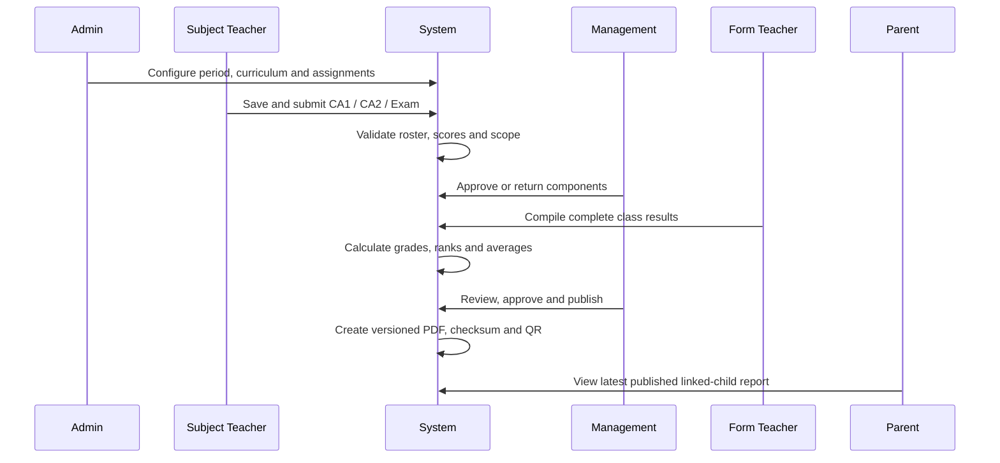

# SAIRS Business Workflows

[← README](../README.md) · [Features](FEATURES.md) · [Business Case Study](BUSINESS_CASE_STUDY.md)

SAIRS joins manual accountability with system automation. “Human” below means a user makes the academic or governance decision; “system” means deterministic processing occurs automatically.

| # | Workflow | Human activity | System automation | Output |
|---:|---|---|---|---|
| 1 | Academic configuration | Admin defines school, period and rules | Validates tenancy, dates, uniqueness and current period | Operational academic context |
| 2 | Student onboarding | Admin enters family or confirms import | Reuses/creates guardian, account, link and enrolment atomically | Student and family access |
| 3 | Teacher onboarding | Admin records staff/responsibilities | Creates account and scoped assignments | Staffed teaching map |
| 4 | Management accounts | Admin creates/statuses/resets reviewer | Secures temporary credential and audits action | Review identity |
| 5 | Assessment capture | Teacher enters and saves scores | Loads roster, validates maxima and persists history | Draft score sheet |
| 6 | Component review | Manager approves or returns | Locks state, records decision and audit | Approved component |
| 7 | Result compilation | Form teacher confirms readiness | Checks completeness; calculates grades, ranks and averages | Compiled class cohort |
| 8 | Result publication | Manager reviews and publishes | Versions reports, builds PDF/QR/checksum and audits | Official reports |
| 9 | Parent access | Parent selects linked child/period | Enforces link and latest-published boundary | View/print/download |
| 10 | Historical retrieval | User selects earlier period | Resolves session placement and snapshots in role scope | Longitudinal record |
| 11 | Public verification | Recipient follows QR/token | Validates publication and checksum | Verified page/PDF |
| 12 | Session rollover | Admin previews and confirms | Copies structure/responsibility safely, preserves old evidence | New session context |
| 13 | Offline synchronisation | User enables PIN; teacher works offline | Encrypts snapshot/outbox; retries and detects conflicts | Reconciled server record |
| 14 | Academic setup import | Admin reviews workbook preview | Validates whole workbook and writes one transaction | Reusable setup |
| 15 | Import recovery | Admin starts student import | Persists/resumes job and protects credential artifact | Recoverable bulk enrolment |
| 16 | Performance review | Authorised user examines history | Produces published-only trends, warnings and guidance | Decision-support view |
| 17 | Report email | Staff requests delivery | Finds active guardian, attaches published PDF, timestamps event | Guardian email |

## Core cross-role process

